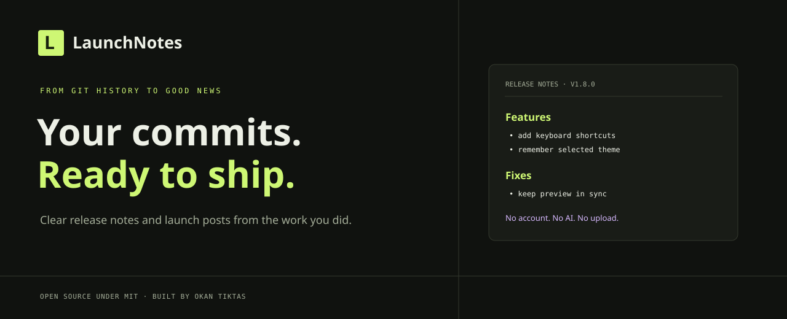

<div align="center">

# LaunchNotes
### Your commits. Ready to ship.

Turn real commit messages into tidy release notes and a launch announcement.

**Free · Local by default · No account · No AI · No API keys**

[Quick start](#quick-start) · [Command line](#command-line) · [Security](SECURITY.md) · [Contribute](CONTRIBUTING.md)



</div>

You’ve finished a feature, fixed bugs, and shipped improvements. Now turn the commit history into release notes people can scan. LaunchNotes groups recognizable commit types, keeps your original wording, suggests a version, and drafts a short launch post. **You review and edit before publishing.**

## Try it in 30 seconds

Requires Node.js 20 or later. No package installation is required.

```sh
npm start
```

Open **http://127.0.0.1:4318**, click **Try the demo**, and edit the example. Everything runs on your computer. Press Ctrl+C in the terminal to stop.

## Your real commits

Copy commit titles from your Git history, one per line. The usual format works especially well:

```text
feat: let readers search release notes
fix(auth): keep sessions active after refresh
perf: reduce startup time
security: validate uploaded file names
docs: explain keyboard shortcuts
chore: update development scripts
```

Paste them into the left box, set your current version, then review the release notes and announcement. Choose **Copy** or **Download .md** when the wording looks right. With no network request or account, you can keep using the local page offline after startup.

### Make a commit list with Git

From a terminal inside your own project, run:

```sh
git log -10 --pretty=format:"%s"
```

Copy the printed commit subjects into LaunchNotes. `-10` selects the latest ten commits; adjust that number for your release. This reads the messages you choose and does not send your repository to LaunchNotes.

## Version suggestions

LaunchNotes follows the conventional commit convention as a practical suggestion:

- `feat` suggests a minor version increase.
- `fix`, `perf`, `docs`, and other recognized changes suggest a patch increase.
- A `!` marker or `BREAKING CHANGE:` marker suggests a major version increase.

This is a convenience, not a release policy. Set the actual version yourself; prerelease tags and zero-version special rules are not inferred.

## Command line

Generate a Markdown changelog from a text file with one commit per line:

```sh
node src/cli.js --input commits.txt --current 1.7.2 --output RELEASE_NOTES.md
```

Pick a release version directly, rename the heading, and include maintenance commits:

```sh
node src/cli.js --input commits.txt --version 1.8.0 --title "What's new" --all --output RELEASE_NOTES.md
```

The CLI reads local text only, limits input size, and refuses to overwrite an existing output file. Run `node src/cli.js --help` to see all options. CLI and browser share the same grouping and version-suggestion engine.

## Categories

`feat` → Features · `fix` → Fixes · `perf` → Performance · `security` → Security · `docs` → Documentation · `refactor`, `style`, `test`, `build`, `ci`, `chore`, `revert` → Maintenance. Unrecognized messages go under Other. Duplicate messages are removed. A `!` or `BREAKING CHANGE:` marks a breaking change. Maintenance messages are hidden until you select **Include maintenance commits**.

The output does not claim that a feature has shipped beyond what its commit text says. It does not generate commit links, infer ticket numbers, verify behavior, or know whether a commit should be public. Do a human review before publishing, especially if commit subjects contain sensitive project or customer details.

## Design choices

- Browser interface and CLI use one plain JavaScript core.
- No third-party JavaScript packages at runtime.
- The server binds to `127.0.0.1`, serves only a fixed list of files, and rejects write methods and unexpected hosts.
- Content is displayed as text, not executed markup.
- Web page policy blocks remote connections; no analytics, storage, API calls, or upload endpoint.
- Repository includes a Node syntax-check workflow for Node 20 and 22 on Linux and Windows.

This is a small open-source tool, not a guarantee of polished or complete release notes. Review its suggestions and your source messages.

## Project layout

```text
src/core.js       Commit parsing, grouping, version suggestions, Markdown
src/cli.js        CLI entry point and safe local file output
src/server.js     Loopback-only static server
web/              Accessible browser application and styling
examples/         Fictional sample commit messages
.github/          Cross-platform syntax-check workflow
```

## Develop

```sh
npm run check
```

See [CONTRIBUTING.md](CONTRIBUTING.md) for safe sample-data rules and focused contribution guidance. Read the [security notes](SECURITY.md) before recommending this tool for sensitive workflows.

Built by **Okan Tiktas**. Released under the MIT License. If LaunchNotes made release day a little easier, share the repository and suggest a commit style it should understand.
